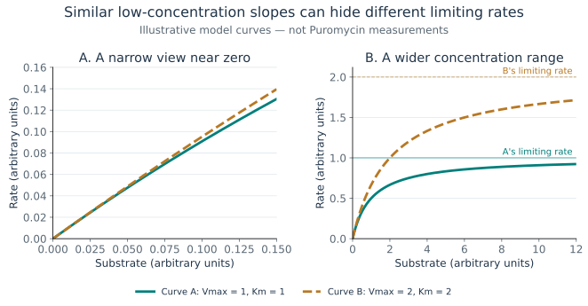
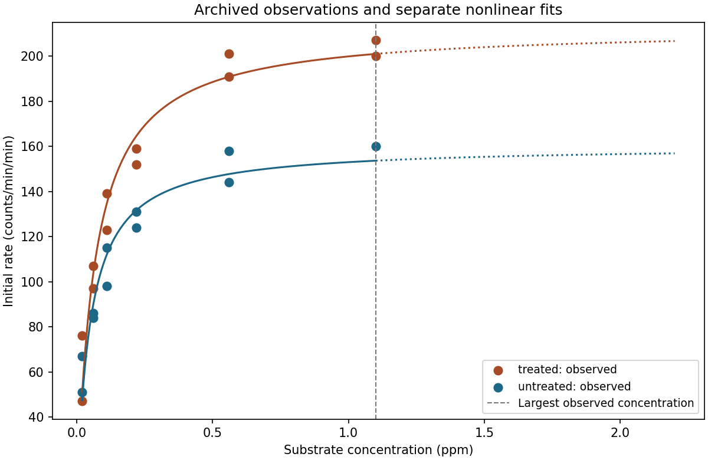
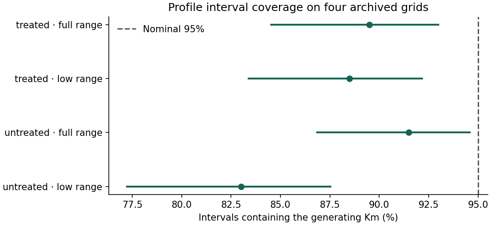

# Enzyme kinetics workbench

Fit a reaction-rate curve to the 23 archived observations in R’s Puromycin dataset, then repeat the fit after removing the high concentrations. The model estimates a limiting rate and the concentration at which the rate reaches half that limit. Comparing the two fits shows how much the upper end of the measured range contributes to each estimate.

## Why this project

In [From biological measurements to better experiments](https://github.com/TheThunda01/TheThunda01/blob/main/PROJECT_GUIDE.md), this is the introductory study: how measurement range constrains what a fitted model can explain.

The two curves in Figure 1 have the same slope at zero and different limiting rates. If measurements cover only the early rise, both curves can look plausible. The workbench uses residuals and parameter intervals to examine that ambiguity in the archive.



**Figure 1. Concentration range changes what a curve can reveal.** This is a mathematical illustration, not Puromycin data: curve A uses $`V_{\max}=K_m=1`$ and curve B uses $`V_{\max}=K_m=2`$ in arbitrary units. Both follow the equation in the [biology guide](docs/biology-and-concepts.md#what-the-michaelismenten-equation-says). The [figure builder](tools/build_documentation_figures.py) records these choices in a [manifest](docs/figures/figure-manifest.json).

## What it does

- Fits positive parameters of the saturating Michaelis–Menten curve separately for the archived `treated` and `untreated` labels, using nine starting points for each fit.
- Plots observed rates, fitted curves and residuals, and marks curve extensions beyond the observed concentration range.
- Profiles the apparent half-saturation parameter, reoptimizing the maximum rate at each candidate value. The resulting intervals depend on the assumed curve and error model and use a large-sample (asymptotic) approximation.
- Refits just the observations at or below 0.11 ppm (parts per million) to show how a narrower range changes the estimates and uncertainty.
- Compares three explicitly hypothetical substrate grids using local information in log-parameter coordinates.
- Provides an optional offline profile explorer linking saved parameter tradeoffs to their predicted curves, with all 964 profile rows checked against the archived observations before rendering.

Here, a substrate is a reacting molecule; half-saturation is the concentration at which the curve reaches half its limiting rate. Local information describes how predictions respond to small parameter changes. Log-parameter coordinates use logarithms of the positive constants.

The separate concentration audit leaves out each complete concentration level in turn, reports changes in apparent parameters, and labels held-out predictions as interpolation or extrapolation relative to the retained range. It preserves the original analysis.

## Quick start

Use Python 3.12 and the pinned dependencies. No R installation, API key or download is needed for the analysis; the source data are included.

```bash
python -m venv .venv
source .venv/bin/activate
python -m pip install -r requirements.txt
python -m unittest discover -s tests -v
python kinetics.py --out .reproduction
```

On Windows, activate the environment with `.venv\Scripts\activate`. The command above writes to `.reproduction/`, keeping the checked-in example intact. Choose another directory with `--out PATH`; omitting `--out` replaces files in `results/`.

Every run verifies the SHA-256 hashes (fingerprints of file bytes) of the bundled source and data, reproduces the CSV conversion from the original R literals, and stops if the inputs do not match.

The command writes five CSV tables, a JSON summary, a UTF-8 Markdown report and four PNG figures. It replaces files with those names in the chosen output directory. You can read [the example report](results/report.md) without running Python.

Run the sensitivity audit separately:

```bash
python audit_kinetics.py --out .reproduction-audit
```

The independent numerical check compares all 16 newly saved full-range, low-range and omitted-level fits using an analytic maximum-rate solution and a one-dimensional half-saturation search:

```bash
python verify_kinetics.py --results-dir .reproduction --audit-dir .reproduction-audit --out .reproduction-verification
```

## Example results

For the treated label, the fitted limiting rate falls from 212.68 to 174.50 counts/min/min when the fit uses only concentrations at or below 0.11 ppm. Compare the `full_range` and `low_range_only` rows in the [parameter estimates](results/parameter_estimates.csv).

**Table 1. Full-range fits to the archived labels.**

| Archived label | Observations | Fitted maximum rate, counts/min/min | Fitted half-saturation, ppm | Approximate 95% profile interval, ppm |
| --- | ---: | ---: | ---: | --- |
| treated | 12 | 212.68 | 0.0641 | 0.0489–0.0830 |
| untreated | 11 | 160.28 | 0.0477 | 0.0334–0.0664 |

The source’s `counts/min/min` means change in radioactive count rate, `(counts/min)`, per minute of reaction time. It is not a turnover rate per enzyme.



**Figure 2. Archived observations and fitted curves.** Source: [included Puromycin data](data/README.md) and [saved parameter estimates](results/parameter_estimates.csv). Dotted extensions are predictions outside the measured concentration range, not additional observations. These fits describe the labels separately and do not establish a treatment mechanism.

Across the 12 concentration-level refits, the largest absolute change in the apparent half-saturation parameter, Km, is 12.66% for the treated label and 27.36% for the untreated label. These are sensitivity summaries, not confidence limits. See the [audit report](examples/concentration-audit/report.md).

All 16 saved fits also pass the [independent numerical check](examples/numerical-verification/verification.json), using relative tolerance `1e-5` and absolute tolerance `1e-7` for parameters and residual sums of squares. This compares the same objective using different numerical code.

Use the [interactive profile explorer](docs/profile-explorer.md) to inspect how each candidate Km changes the reoptimized Vmax and predicted curve. It retains excluded observations and marks extrapolation, making the low-range parameter tradeoff easier to inspect without changing the analysis.

### How often do the intervals cover a known Km?

The [coverage study](examples/interval-coverage/report.md) reuses the archived concentration grids and generates responses from a curve with known parameters. Each row in the report counts how often the fitted Km interval contains its generating value across 200 simulated datasets. On the untreated grid, the interval contained the generating Km in 183 of 200 full-range runs and 166 of 200 low-range runs. Whiskers show the Monte Carlo uncertainty in each fraction.



Run `python interval_coverage.py --out .reproduction-coverage` to regenerate the chart and [counts](examples/interval-coverage/coverage.csv). This checks coverage for the declared curve and noise model. Whether that model describes the original archived errors remains an open question.

## Practical use and limitations

The archive lacks the metadata needed to reconstruct the experiments. The [official R documentation](https://stat.ethz.ch/R-manual/R-devel/library/datasets/html/Puromycin.html) describes one treated and one untreated experiment but supplies no experimental-unit identifiers. Repeated rows at a concentration therefore do not establish independent biological replication. The thesis title cited by R mentions galactosyltransferase in Golgi membranes, but that attribution does not establish a species, detailed protocol or inhibition mechanism for this reduced table.

The model assumes a simple saturating relationship. A good fit does not verify its mechanism, establish enzyme turnover, or demonstrate that experimental saturation was reached. Concentrations are in ppm; the fitted half-saturation parameter is not a molar binding affinity.

The uncertainty calculations assume independent, constant-variance normally distributed (Gaussian) errors. The archive establishes neither those assumptions nor small-sample interval coverage. The hypothetical information comparison holds the model and noise fixed and is not a validated experimental design recommendation.

## Documentation

The [21 October 2026 maintenance and scientific review](docs/review-2026-10-21.md) records the latest checks and their limits. Earlier review records remain available below.

| Guide | What you will find |
| --- | --- |
| [Project context](docs/project-context.md) | Question, rationale and skills |
| [Biology and concepts](docs/biology-and-concepts.md) | Meaning of rates, parameters and uncertainty |
| [Methods](docs/methods.md) | Exact model, numerical choices and output fields |
| [References](docs/references.md) | Primary literature and related tools |
| [Data provenance](data/README.md) | Source revision, conversion, hashes and terms |
| [Practical use](docs/practical-use.md) | Worked audit and acceptance checks |
| [Literature review](docs/literature-review.md) | Search, appraisal and implementation decisions |

Definitions and interpretation: [glossary](docs/glossary.md), [assumptions](docs/assumptions.md), [reference audit](docs/reference-audit.json) and [dated review](docs/review-2026-10-20.md).

## Development and reuse

The [methods](docs/methods.md) describe equations, parameter bounds, output fields and failure cases. Tests cover known-parameter recovery, analytic derivatives, source integrity, profile calculations, invalid inputs and an end-to-end run. GitHub Actions runs those tests and reproduces all outputs. See [CONTRIBUTING.md](CONTRIBUTING.md) for changing the analysis responsibly.

Original code and documentation use the [MIT license](LICENSE). The bundled R source files and converted dataset retain their separate [GPL-2.0-or-later terms](data/README.md).

Rebuild Figure 1 with `python tools/build_documentation_figures.py`. It writes only `docs/figures/` and does not rerun or replace the archived-data analysis.
