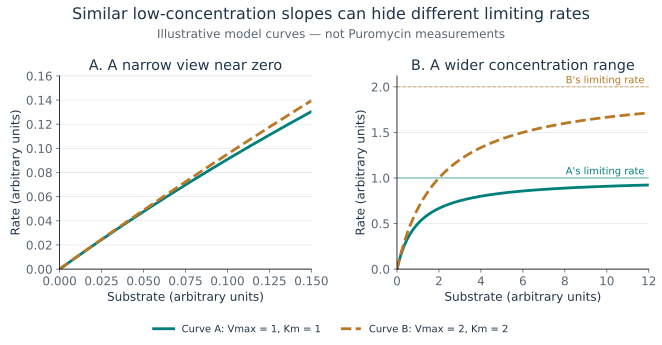

# The biology and mathematics behind the curves

## From a reaction to a measured rate

An enzyme is a biological catalyst: it changes the rate of a reaction without being consumed in the overall transformation. The substrate is a reacting molecule. Enzyme kinetics connects reaction rate to quantities such as substrate availability, using a model that simplifies a much richer molecular process.

Here the observations come from R's `Puromycin` archive. Its concentration column is in parts per million, and its rate column is in counts/min/min: change in count rate `(counts/min)` per minute of reaction time. The documentation describes calculating initial reaction rates from measurements of radioactive product. These are instrument-linked rates, not directly a count of molecules converted per enzyme per second. Without calibration and enzyme-amount information, this project cannot calculate a turnover number. [R Core Team (pinned 2026 snapshot)](references.md#data-and-historical-attribution)

R attributes the dataset to Treloar's thesis, whose title mentions galactosyltransferase in Golgi membranes. That is useful historical context, but the reduced table does not identify a species, substrate identity, enzyme concentration or complete assay conditions. The documentation refers to cells in its description and to treated versus untreated enzyme in its details. We preserve the labels without resolving that ambiguity through guesswork. It describes one experiment for each label; rows repeated at a concentration do not establish independent biological replication. [R Core Team (pinned 2026 snapshot)](references.md#data-and-historical-attribution)

## What the Michaelis–Menten equation says

The fitted relationship is

```math
v(S)=\frac{V_{\max}S}{K_m+S}.
```

Here $`S`$ is substrate concentration and $`v`$ is initial rate. $`V_{\max}`$ is the model's limiting rate as substrate becomes very large. $`K_m`$ is the concentration at which that model predicts half its limiting rate. These two definitions follow directly from the equation; they do not depend on identifying the molecular mechanism.

The classical mechanistic interpretation begins with enzyme and substrate forming a complex that can dissociate or produce product. The steady-state approximation treats the enzyme–substrate complex as changing negligibly during the initial-rate period. Under that treatment, $`K_m=(k_{-1}+k_{\mathrm{cat}})/k_1`$. Here $`k_1`$ describes association, $`k_{-1}`$ dissociation and $`k_{\mathrm{cat}}`$ catalytic turnover for that simple mechanism. $`K_m`$ therefore does not generally equal the equilibrium binding dissociation constant, $`K_d`$. Briggs and Haldane developed the steady-state treatment; Johnson and Goody discuss the historical Michaelis–Menten work and its assumptions. [Briggs and Haldane (1925) and Johnson and Goody (2011)](references.md#kinetics-and-identifiability)

For this archive, the fitted parameters are best described as **apparent kinetic parameters** in the recorded units. In particular, a value in ppm is not a molar binding affinity. The curve also assumes no extra baseline term, no substrate inhibition and no cooperative dependence. Those alternatives are not ruled out simply because a two-parameter curve fits reasonably well.

## Why measurement range matters

Figure 1 makes the limiting behavior concrete. The two parameter pairs were chosen only to share the same slope at zero; they are not fitted to the archived observations.



**Figure 1. A narrow rising segment versus a wider view of the same two curves.** Source: the equation above and [declared illustrative parameters](figures/figure-manifest.json), generated by [the figure script](../tools/build_documentation_figures.py). No noise or biological measurements are represented.

At concentrations much smaller than $`K_m`$, the equation is approximately $`v=(V_{\max}/K_m)S`$. A nearly straight rising section mostly identifies a ratio: increasing both parameters together can leave similar predicted rates. At concentrations much larger than $`K_m`$, the curve approaches $`V_{\max}`$, while changes in $`K_m`$ have less influence. These are mathematical limits of this model, not claims about which conditions occurred in the original experiment.

Table 1 connects each part of the curve with the interpretation it can support. It is a guide to this model's mathematical behavior, not an experimental-design prescription.

**Table 1. Reading information from a saturating curve.**

| Part of the curve | What mainly changes the prediction | What remains difficult to establish |
| --- | --- | --- |
| Near zero substrate | The ratio $`V_{\max}/K_m`$ controls the initial slope. | The two parameters separately, especially with noise and limited range. |
| Near half-saturation | Curvature makes changes in $`K_m`$ more visible. | Whether the assumed mechanism and error model are correct. |
| At much larger substrate | The predicted rate approaches $`V_{\max}`$. | Whether real measurements reached saturation or follow this model outside the sampled range. |

The equation and references in the preceding section support Table 1; the [assumption register](assumptions.md) explains the limits of applying it to this archive.

The full archived range is 0.02–1.1 ppm. The workbench deliberately repeats the fits after retaining only concentrations at or below 0.11 ppm. Both estimated maximum rates change. This illustrates sensitivity to the observed range; it does not prove either estimate is biologically correct. The dotted extensions beyond 1.1 ppm make another distinction visible: they are extrapolations from the assumed curve, with no observations there to validate them.

## A good-looking fit can still leave uncertainty

Structural identifiability asks whether perfect observations could distinguish parameters under a specified model. Practical identifiability asks how much the actual observations constrain them. The distinction matters because noise and a limited range can leave many plausible parameter combinations even when a model is identifiable in principle. [Raue et al. (2009) and Wanika et al. (2024)](references.md#kinetics-and-identifiability)

This project explores practical uncertainty with a profile. For each candidate $`K_m`$, it finds the best accompanying $`V_{\max}`$ and measures how much worse the fit becomes. A shallow profile means that moving the parameter changes the best achievable fit only slightly. The displayed approximate intervals use a Gaussian, independent, constant-variance error model and an asymptotic likelihood-ratio cutoff. There are only 12 or 11 observations in the full groups, and their independence is not documented. The intervals are therefore conditional illustrations, not validated small-sample coverage statements.

Residuals show where observations lie above or below the fitted curve. A systematic pattern can suggest model mismatch; different scatter at different concentrations can challenge constant variance. A quiet-looking plot cannot prove either assumption with so few points. The script does not automatically delete observations or treat outliers as mistakes.

## Information, design and responsible interpretation

A separate calculation compares low, near-half-saturation and wide concentration ranges for a hypothetical model with $`V_{\max}=K_m=1`$. It uses derivatives with respect to log parameters to quantify local sensitivity. Under independent equal-variance errors, the matrix $`J^\mathsf{T}J`$ summarizes local information. Its condition number indicates how unevenly the chosen parameter directions are informed.

The wide range is less degenerate in this specific calculation. That result depends on the fixed parameter values, noise model, units and log-parameter coordinates. It is not an optimized or experimentally validated assay plan. Real measurement choices would also require biological feasibility, costs, calibration and a defensible error model. [Wanika et al. (2024)](references.md#kinetics-and-identifiability)

The main lesson is to connect each conclusion to its evidence. The archive supports reproducible curve descriptions and sensitivity checks. It does not establish why the labels differ, how puromycin acted, or what would happen in another biological system. See [references](references.md) for source roles and access limits and [methods](methods.md) for the exact implementation.

For definitions, see the [glossary](glossary.md); for the rationale and limits of each material choice, see the [assumptions](assumptions.md).
