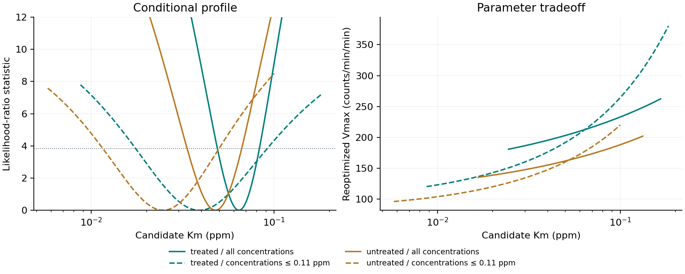

# Inspect the parameter tradeoff

The [offline profile explorer](../examples/profile-explorer/profile-explorer.html) links the saved half-saturation profile to the curve it predicts. Download the HTML and open it locally; GitHub displays the source rather than running the application. All plotting code and data are embedded, so viewing needs no server, account, or network connection.

Choose an archived label and either the full or low concentration range. Move the slider or click a point in either lower plot. The upper plot updates to the conditional curve: Km is fixed at that saved point and Vmax has been reoptimized. The dashed green curve remains the best fit. Faded crosses retain observations excluded from a low-range fit; dotted orange segments mark predictions outside the range used to fit that curve. Reset returns to the smallest saved likelihood ratio.



This preview shows the four saved profiles. The HTML adds the linked candidate curve and exact-value hover details. A profile cutoff does not define a prediction confidence band. Similar curves can arise from different parameter pairs, and narrow-range estimates can depend strongly on that tradeoff.

## Rebuild and check

In a separate environment, install the optional visualization requirements:

```bash
python -m pip install -r requirements-visualization.txt
python tools/build_profile_explorer.py --out .reproduction-explorer
```

The builder reads the original observations plus `results/summary.json` and `results/km_profiles.csv`; it does not change them or rerun fitting. `--results-dir PATH` selects a separately reproduced result directory. Before rendering, it recomputes conditional Vmax, residual sums of squares, and likelihood ratios for all **964 profile rows** using the archived observations. Changed parameters or objective values fail. The [manifest](../examples/profile-explorer/manifest.json) records source/output hashes and versions. Core analysis requirements remain unchanged; Plotly 7.1.0 is an optional build dependency. Embedded Plotly.js retains its MIT license header. The standalone file is about 5 MB because the plotting library is included.

## Interpretation

All quantities retain their archived units: Km is in ppm; Vmax and observed rates are in counts/min/min, not enzyme turnover. The two labels are separate descriptive fits, and repeated concentration rows do not identify independent biological replicates. The approximate 95% profile criterion assumes independent constant-variance Gaussian errors and uses an asymptotic cutoff; small-sample coverage has not been calibrated.

The viewer is a different way to inspect the existing [methods](methods.md) and saved results, not a new uncertainty method or biological experiment. Its curve updates use the existing saturating equation with saved conditional parameters. It does not estimate an inhibition mechanism or turn the label contrast into a causal effect. The [Plotly Python documentation](https://plotly.com/python/interactive-html-export/) describes the HTML export mechanism; the data checks and linked-view code were written for this repository with AI assistance.
