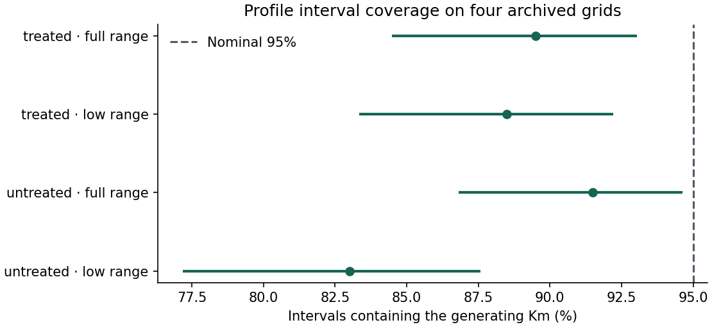

# How often did the interval include the generating Km?

Each grid uses 200 simulated response sets and its archived concentration values. The generating curve has Vmax 180 and Km 0.06, with independent Gaussian errors of standard deviation 6. The random seed is 182.

| Archived grid | Range | Covered / completed | Failed fits or profiles | Intervals with an open end |
| --- | --- | ---: | ---: | ---: |
| treated | full range | 179/200 | 0 | 0 |
| treated | low range | 177/200 | 0 | 0 |
| untreated | full range | 183/200 | 0 | 0 |
| untreated | low range | 166/200 | 0 | 0 |

Whiskers show 95% Wilson intervals for the simulated coverage fraction among completed runs. An open end includes all candidate values in that direction up to the workbench’s computational bound. Only the concentration grids come from the archive. Coverage here describes the declared synthetic curve and noise.
