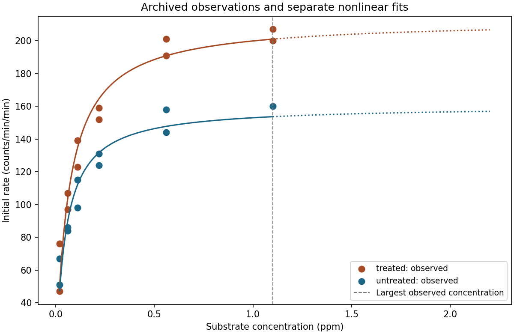
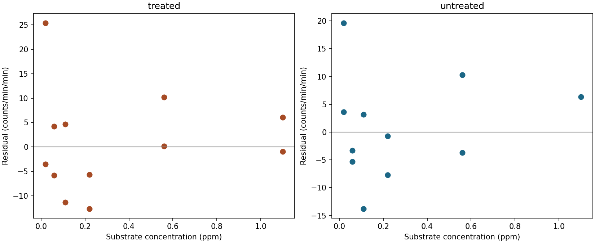
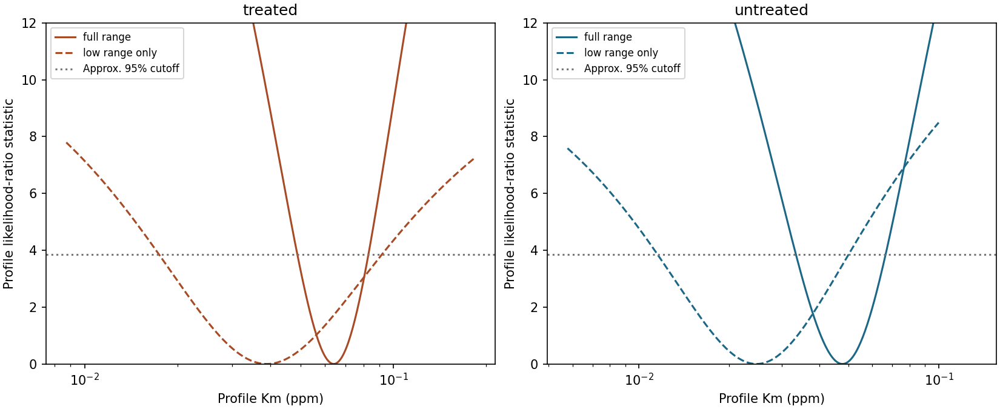
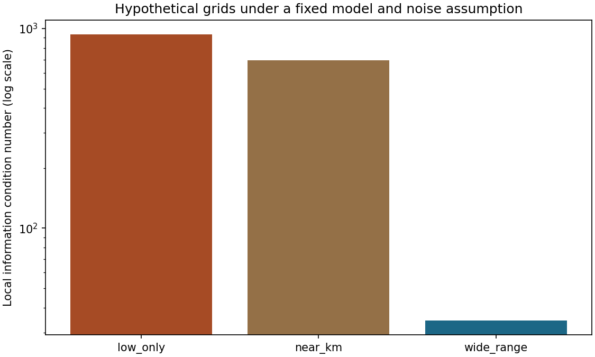

# Enzyme kinetics workbench: example results

These are fitted descriptions of the archived R Puromycin data, not new measurements or a causal treatment experiment.

| State | Scope | Rows | Vmax (counts/min/min) | Km (ppm) | Approx. 95% profile interval for Km |
| --- | --- | ---: | ---: | ---: | --- |
| treated | full_range | 12 | 212.68 | 0.0641 | 0.0489–0.0830 |
| treated | low_range_only | 6 | 174.50 | 0.0389 | 0.0174–0.0917 |
| untreated | full_range | 11 | 160.28 | 0.0477 | 0.0334–0.0664 |
| untreated | low_range_only | 6 | 126.75 | 0.0247 | 0.0115–0.0500 |

The low-range refits deliberately use only concentrations at or below 0.11 ppm. They show sensitivity to removing observed high-concentration data, not a recommendation for future assays. Profile intervals assume independent, constant-variance Gaussian errors and use an asymptotic cutoff; coverage is not validated for these small archived runs.

Solid curves span the observed range; dotted extensions above 1.1 ppm have no validating observations. The model's asymptote is not direct evidence that saturation was experimentally established.

Residuals are observed minus fitted rate. Scatter without a visible pattern does not prove the error assumptions.

The horizontal line is the approximate 95% likelihood-ratio cutoff. An open profile endpoint means the cutoff was not reached within broad computational bounds, not that the true parameter is infinite.

These dimensionless comparisons fix Vmax = Km = 1, twelve independent measurements and unit error variance. The grids are mathematical scenarios, not observed data or validated experimental designs. Lower condition numbers indicate less local degeneracy for the chosen log-parameter coordinates only.

See [methods](../docs/methods.md), [biology and concepts](../docs/biology-and-concepts.md), and [provenance](../data/README.md) before interpreting these estimates.
